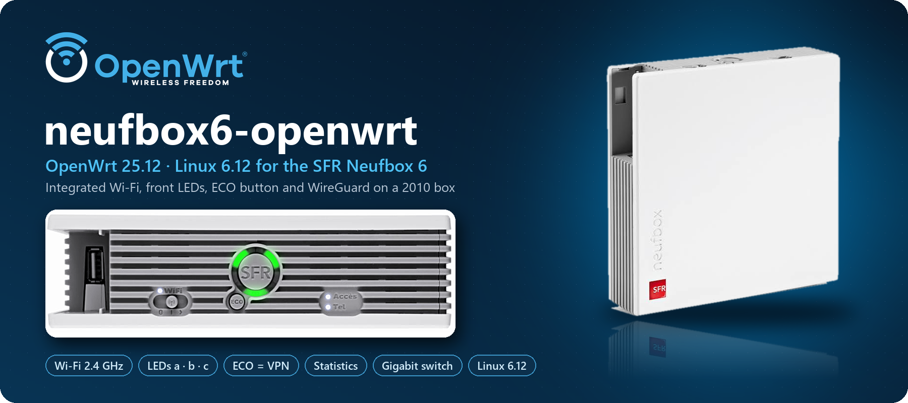
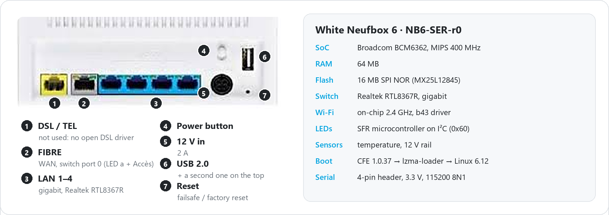
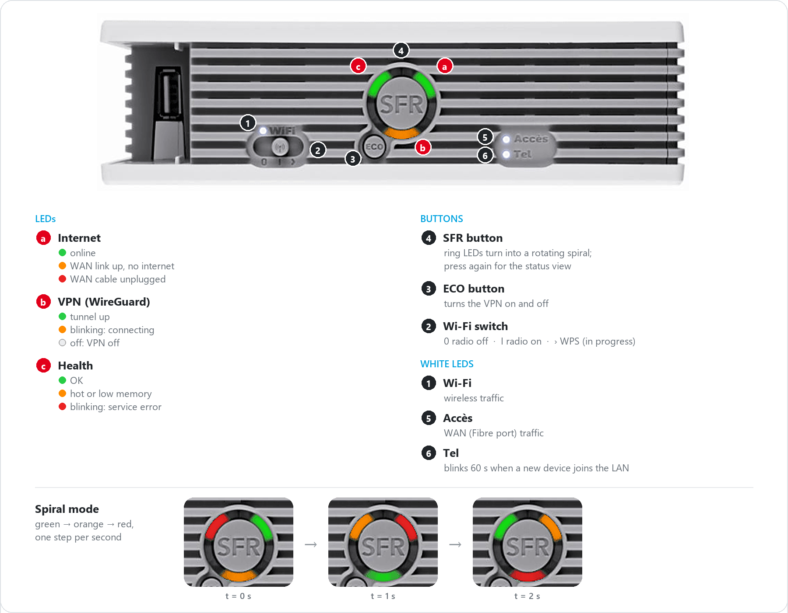
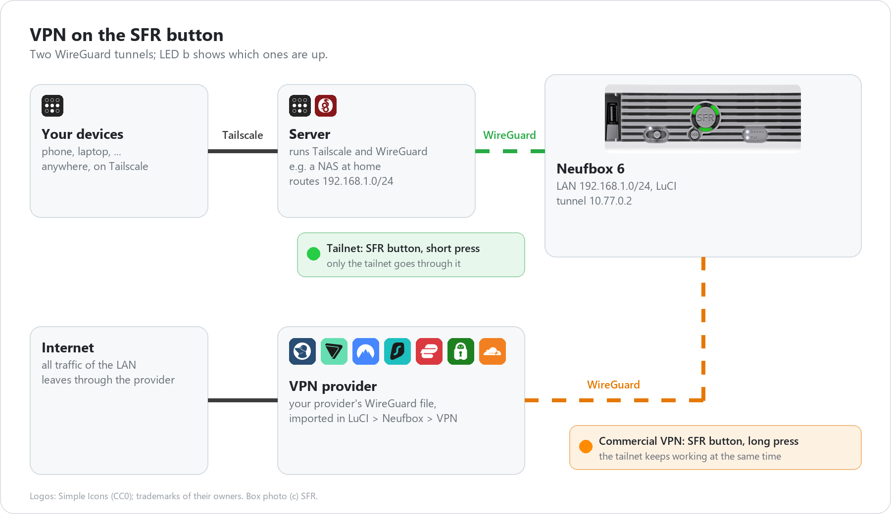
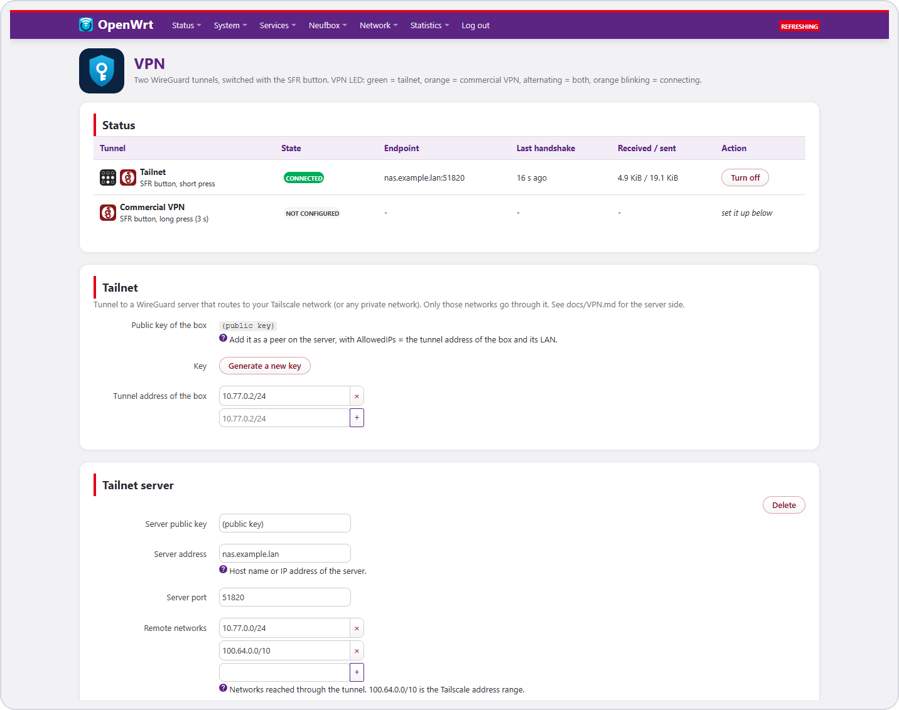
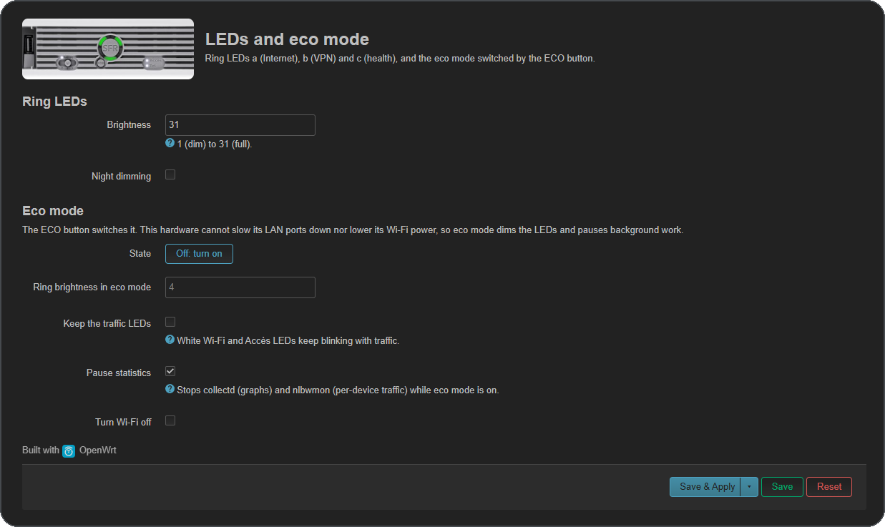

<p align="center">
  
</p>

<p align="center">
  
  
  
  
  
  
  <a href="https://github.com/JavaScript-X/neufbox6-openwrt/releases/latest"></a>
</p>

<p align="center">
  <b>Unofficial OpenWrt 25.12 (Linux 6.12) for the white SFR Neufbox 6 "Box Évolution" (NB6-SER-r0)</b><br>
  Integrated Wi-Fi, front LEDs, SFR and ECO buttons and sensors, none of which the last official build (23.05) supported.
</p>

---

## Why

The Neufbox 6 was SFR's ADSL/fibre box in the 2010s. Thousands ended up as e-waste. OpenWrt supported it up to
**23.05**, then dropped the whole `bcm63xx` target. This project moves the box to the modern **`bmips`** target and
goes further than the official port ever did:

| | OpenWrt 23.05 (official, last) | **neufbox6-openwrt** |
|---|:---:|:---:|
| OpenWrt / Linux | 23.05 / 5.15 | **25.12 / 6.12** |
| Security updates | ❌ end of life | ✅ follows the 25.12 branch |
| Integrated Wi-Fi | ❌ | ✅ access point, WPA2 |
| Front LEDs (a/b/c, wan, voip, wlan) | ❌ | ✅ with status meanings |
| SFR button | ❌ | ✅ tailnet / commercial VPN on/off |
| ECO button | ❌ | ✅ eco mode |
| Sensors (temperature, voltage) | ❌ | ✅ with graphs in LuCI |
| Compressed swap (zram), watchdog | ❌ | ✅ |
| Wi-Fi schedule, LED night mode | ❌ | ✅ |
| Gigabit switch, USB, WAN "Fibre" port | ✅ | ✅ |

## Hardware

<p align="center"></p>

<p align="center"></p>

BCM6362 @ 400 MHz · 64 MB RAM · 16 MB SPI NOR · Realtek RTL8367R gigabit switch · BCM6362 integrated 2.4 GHz radio ·
SFR LED/sensor microcontroller on I²C. Full details, GPIO map, flash layout and the microcontroller's registers:
**[docs/HARDWARE.md](docs/HARDWARE.md)**.

## LEDs and buttons

<p align="center"></p>

> Tested on real hardware: LED colours and order, SFR and ECO buttons, eco mode, Wi-Fi switch, sensors (51 °C, 12.2 V).
> Work in progress: WPS (switch pushed past "on") is detected but does not start pairing yet, because hostapd in OpenWrt 25.12 exposes no per-interface WPS call here. See [docs/LEDS-BUTTONS.md](docs/LEDS-BUTTONS.md).

- **SFR** button → short press: **tailnet** tunnel (Tailscale network through a WireGuard server); long press: **commercial VPN**. LED **b** shows which tunnels are up. → **[docs/VPN.md](docs/VPN.md)**
- **ECO** button → **eco mode**: ring LEDs dimmed, traffic LEDs off, statistics paused (optionally Wi-Fi off); kept across reboots.
- **Wi-Fi switch** → radio on / off; pushed further → **WPS** (work in progress).

More in **[docs/LEDS-BUTTONS.md](docs/LEDS-BUTTONS.md)**.

## VPN: Tailscale and commercial VPN

<p align="center"></p>

Tailscale itself does not fit in 64 MB, so the box reaches your tailnet through a small WireGuard tunnel to a
machine that already runs Tailscale (a NAS, for example). A second tunnel sends all traffic through a commercial
provider (Mullvad, Proton VPN, NordVPN, ...). → **[docs/VPN.md](docs/VPN.md)**

## Web interface

The **Neufbox** menu in LuCI shows both tunnels, imports a provider's WireGuard file, and sets the LEDs and eco mode.

<p align="center">
   VPN" width="49%">
   LEDs and eco mode" width="49%">
</p>

## Integrated Wi-Fi

The BCM6362's on-chip radio never worked under OpenWrt. It now runs with the open **b43** driver thanks to
Alessio Ferri's 2026 work on the same SoC, Linux mainline patches, and the Neufbox's **own radio calibration**
recovered from the SFR firmware. 2.4 GHz access point, WPA2, 802.11g rates, 0 % packet loss in tests.
5 GHz is physically absent on this board. → **[docs/WIFI.md](docs/WIFI.md)**

## Extras

More out of 64 MB of RAM: **zram** compressed swap, hardware **watchdog**, **graphs** of temperature, 12 V,
CPU, RAM and traffic, **per-device traffic** (nlbwmon), **Wi-Fi schedule**, LED **brightness and night mode**,
**Wake-on-LAN** and a **web terminal** in LuCI. → **[docs/EXTRAS.md](docs/EXTRAS.md)**

## Getting started

### Download
Ready-made images are on the **[releases page](https://github.com/JavaScript-X/neufbox6-openwrt/releases/latest)**:
`…-squashfs-cfe.bin` for the first install, `…-squashfs-sysupgrade.bin` for updates, with SHA-256 checksums.
Back up the whole flash first ([docs/FLASHING.md](docs/FLASHING.md#full-flash-backup)).

### 1. Build it yourself (Docker, optional)
```sh
git clone https://github.com/JavaScript-X/neufbox6-openwrt.git
cd neufbox6-openwrt
docker build -t nb6-builder docker/
docker run --rm --network host -v "$PWD":/port:ro -v "$HOME/nb6-work":/work nb6-builder /port/scripts/build.sh
```
Images land in `~/nb6-work/openwrt/bin/targets/bmips/bcm6362/`. → **[docs/BUILD.md](docs/BUILD.md)**

### 2. First flash (serial console + TFTP)
The stock CFE bootloader is kept: interrupt it on the serial console and flash
`…-squashfs-cfe.bin` over TFTP. → **[docs/FLASHING.md](docs/FLASHING.md)**

### 3. Updates
`sysupgrade` with `…-squashfs-sysupgrade.bin` (LuCI or command line), settings kept.

## How it boots

<p align="center"></p>

The 2010 CFE bootloader can only unpack ~4 MB and lives in the middle of RAM, while the 6.12 kernel is 11 MB.
The image therefore ships a small **lzma-loader** that CFE unpacks first, which then unpacks the kernel itself.

## Documentation

| Document | Content |
|---|---|
| [docs/HARDWARE.md](docs/HARDWARE.md) | board, GPIO map, flash layout, microcontroller registers |
| [docs/BUILD.md](docs/BUILD.md) | building the firmware with Docker |
| [docs/FLASHING.md](docs/FLASHING.md) | first flash from CFE, updates, going back to the SFR firmware |
| [docs/WIFI.md](docs/WIFI.md) | integrated Wi-Fi: driver, firmware, calibration |
| [docs/LEDS-BUTTONS.md](docs/LEDS-BUTTONS.md) | LEDs, buttons, sensors |
| [docs/VPN.md](docs/VPN.md) | tailnet and commercial VPN on the SFR button |
| [docs/EXTRAS.md](docs/EXTRAS.md) | zram, watchdog, statistics, Wi-Fi schedule, night mode, Wake-on-LAN, terminal |
| [docs/PORTING.md](docs/PORTING.md) | how the port was done, bring-up problems, test results |
| [CHANGELOG.md](CHANGELOG.md) | changes per version |

## Repository

```
assets/            photos and diagrams used in this README
config/nb6.config  OpenWrt target and package selection
docker/            Debian 12 build environment
docs/              hardware, build, flashing, Wi-Fi, LEDs and buttons, extras, porting notes
files/             added to the image: LED daemon and its settings, VPN and eco helpers, LuCI pages, button handlers, first-boot defaults
patches/board/     device tree, image recipe, RTL8367R RGMII fix, nb6-hwmon LED driver
patches/wifi/      BCM6362 WLAN: bcma host, b43 N-PHY r8 / radio 2057 r8, firmware, calibration
scripts/           build.sh, apply-board.sh, apply-wifi.sh
tools/             serial console, CFE, TFTP and GPIO helpers for flashing and probing
```

## Limits

- Experimental: first flash needs a 3.3 V serial adapter; keep it for recovery.
- Wi-Fi: 2.4 GHz only, 802.11g rates for now (b43's 802.11n support for this radio is unfinished).
- No ADSL/VDSL, no VoIP (closed Broadcom drivers).
- Kernel modules from the official package feed do not match this kernel: add them to `config/nb6.config` and rebuild.

## Credits

- **Álvaro Fernández Rojas** (noltari) wrote the `bmips` target and the original `nb6-hwmon` LED/sensor driver (2020).
- **Alessio Ferri** added BCM6362 integrated WLAN support: bcma SoC host, b43 N-PHY rev 8 / radio 2057 rev 8, firmware extraction (2026).
- **Miguel Gaio / Efixo** did the original Neufbox OpenWrt work and the RTL8367R RGMII fix.
- The **OpenWrt** and **Linux** communities.

Third-party patches keep their original authorship and trailers. SFR firmware images and calibration files are **not**
distributed here.

Product photos of the Neufbox 6 in `assets/banner-openwrt.png`, `assets/leds-buttons.png`, `assets/hardware.png`, `assets/vpn.png` and the LuCI screenshots: © SFR,
annotated for this project. Neufbox and SFR are trademarks of SFR; this project is not affiliated with SFR.
Brand icons in the LuCI pages (`files/www/luci-static/resources/nb6/icons.js`), `assets/banner-openwrt.png` and `assets/vpn.png`: [Simple Icons](https://simpleicons.org), CC0 1.0;
the names and logos are trademarks of their owners and only identify their services. The photo in
`files/www/luci-static/resources/nb6/box-top.jpg` is an SFR product photo (© SFR).
The OpenWrt logo in `assets/banner-openwrt.png` is by the OpenWrt project, [CC BY-SA 4.0](https://creativecommons.org/licenses/by-sa/4.0/)
(shown in its white variant for the dark background); OpenWrt is a registered trademark of Software Freedom Conservancy.

## Licence

GPL-2.0-or-later, see [LICENSE](LICENSE).
