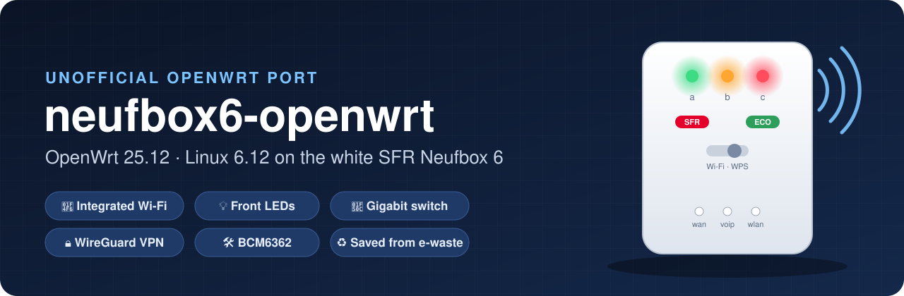
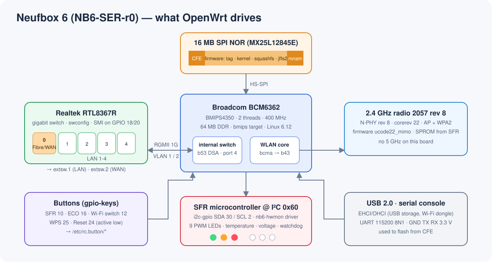
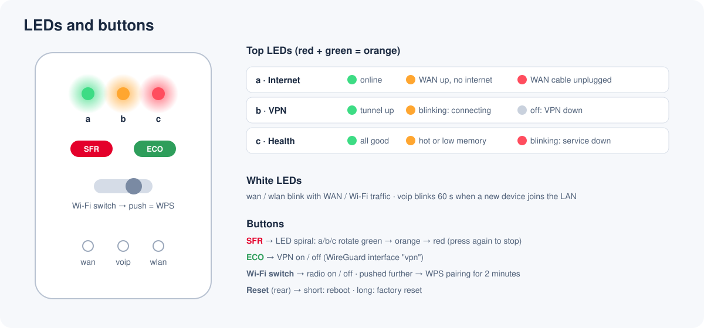
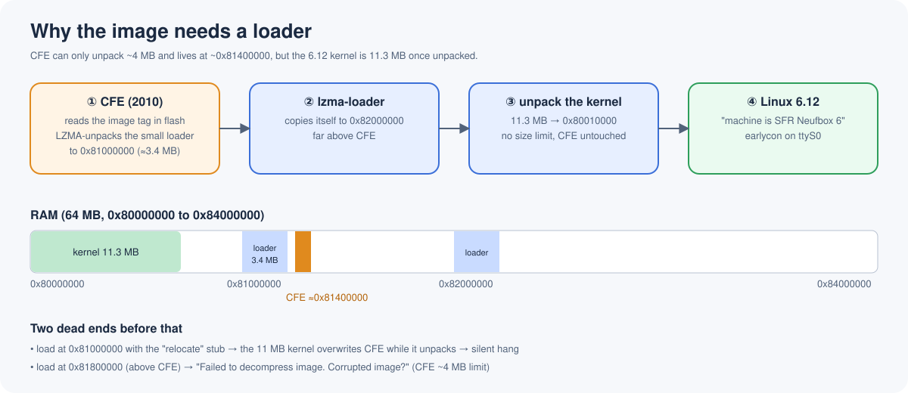

<p align="center">
  
</p>

<p align="center">
  
  
  
  
  
  
</p>

<p align="center">
  <b>Unofficial OpenWrt 25.12 (Linux 6.12) for the white SFR Neufbox 6 "Box Évolution" (NB6-SER-r0)</b><br>
  integrated Wi-Fi · front LEDs · ECO button · gigabit switch · WireGuard — none of which the last official build (23.05) had.
</p>

---

## ✨ Why

The Neufbox 6 was SFR's ADSL/fibre box in the 2010s. Thousands ended up as e-waste. OpenWrt supported it up to
**23.05**, then dropped the whole `bcm63xx` target. This project moves the box to the modern **`bmips`** target and
goes further than the official port ever did:

| | OpenWrt 23.05 (official, last) | **neufbox6-openwrt** |
|---|:---:|:---:|
| OpenWrt / Linux | 23.05 / 5.15 | **25.12 / 6.12** |
| Security updates | ❌ end of life | ✅ follows the 25.12 branch |
| Integrated Wi-Fi | ❌ | ✅ access point, WPA2 |
| Front LEDs (a/b/c, wan, voip, wlan) | ❌ | ✅ with status meanings |
| ECO button | ❌ | ✅ VPN on/off |
| Sensors (temperature, voltage) | ❌ | ✅ |
| Gigabit switch, USB, WAN "Fibre" port | ✅ | ✅ |

## 🧩 Hardware

<p align="center"></p>

BCM6362 @ 400 MHz · 64 MB RAM · 16 MB SPI NOR · Realtek RTL8367R gigabit switch · BCM6362 integrated 2.4 GHz radio ·
SFR LED/sensor microcontroller on I²C. Full details, GPIO map, flash layout and the microcontroller's registers:
**[docs/HARDWARE.md](docs/HARDWARE.md)**.

## 💡 LEDs and buttons

<p align="center"></p>

> ✅ Tested on real hardware: LED colours and order, SFR spiral, ECO button, Wi-Fi switch, sensors (51 °C, 12.2 V).
> 🧪 WPS (switch pushed past "on") is detected but does not start pairing yet: hostapd in OpenWrt 25.12 exposes no per-interface WPS call here. See [docs/LEDS-BUTTONS.md](docs/LEDS-BUTTONS.md).

- **SFR** button → the three top LEDs turn into a rotating green / orange / red **spiral**; press again for the status view.
- **ECO** button → turns the **WireGuard VPN** (interface `vpn`) on and off; LED **b** shows the tunnel state.
- **Wi-Fi switch** → radio on / off; pushed further → **WPS** (work in progress).

More in **[docs/LEDS-BUTTONS.md](docs/LEDS-BUTTONS.md)**.

## 📶 Integrated Wi-Fi

The BCM6362's on-chip radio never worked under OpenWrt. It now runs with the open **b43** driver thanks to
Alessio Ferri's 2026 work on the same SoC, Linux mainline patches, and the Neufbox's **own radio calibration**
recovered from the SFR firmware. 2.4 GHz access point, WPA2, 802.11g rates, 0 % packet loss in tests.
5 GHz is physically absent on this board. → **[docs/WIFI.md](docs/WIFI.md)**

## 🚀 Getting started

### 1. Build (Docker)
```sh
git clone https://github.com/JavaScript-X/neufbox6-openwrt.git
cd neufbox6-openwrt
docker build -t nb6-builder docker/
docker run --rm --network host -v "$PWD":/port:ro -v "$HOME/nb6-work":/work nb6-builder /port/scripts/build.sh
```
Images land in `~/nb6-work/openwrt/bin/targets/bmips/bcm6362/`. → **[docs/BUILD.md](docs/BUILD.md)**

### 2. First flash (serial console + TFTP)
The stock CFE bootloader is kept: interrupt it on the serial console and flash
`…-squashfs-cfe.bin` over TFTP. → **[docs/FLASHING.md](docs/FLASHING.md)**

### 3. Updates
`sysupgrade` with `…-squashfs-sysupgrade.bin` (LuCI or command line), settings kept.

## 🔍 How it boots

<p align="center"></p>

The 2010 CFE bootloader can only unpack ~4 MB and lives in the middle of RAM, while the 6.12 kernel is 11 MB.
The image therefore ships a small **lzma-loader** that CFE unpacks first, which then unpacks the kernel itself.

## 📁 Repository

```
assets/            illustrations used in this README
config/nb6.config  OpenWrt target and package selection
docker/            Debian 12 build environment
docs/              hardware, build, flashing, Wi-Fi, LEDs, porting journal
files/             added to the image: LED daemon, button handlers, first-boot defaults
patches/board/     device tree, image recipe, RTL8367R RGMII fix, nb6-hwmon LED driver
patches/wifi/      BCM6362 WLAN: bcma host, b43 N-PHY r8 / radio 2057 r8, firmware, calibration
scripts/           build.sh, apply-board.sh, apply-wifi.sh
tools/             serial / CFE / TFTP / GPIO helpers used for flashing and probing
```

## ⚠️ Limits

- Experimental: first flash needs a 3.3 V serial adapter; keep it for recovery.
- Wi-Fi: 2.4 GHz only, 802.11g rates for now (b43's 802.11n support for this radio is unfinished).
- No ADSL/VDSL, no VoIP (closed Broadcom drivers).
- Kernel modules from the official package feed do not match this kernel: add them to `config/nb6.config` and rebuild.

## 🙏 Credits

- **Álvaro Fernández Rojas** (noltari) — the `bmips` target and the original `nb6-hwmon` LED/sensor driver (2020).
- **Alessio Ferri** — BCM6362 integrated WLAN support: bcma SoC host, b43 N-PHY rev 8 / radio 2057 rev 8, firmware extraction (2026).
- **Miguel Gaio / Efixo** — the original Neufbox OpenWrt work and the RTL8367R RGMII fix.
- The **OpenWrt** and **Linux** communities.

Third-party patches keep their original authorship and trailers. SFR firmware images and calibration files are **not**
distributed here.

## 📜 Licence

GPL-2.0-or-later — see [LICENSE](LICENSE).
