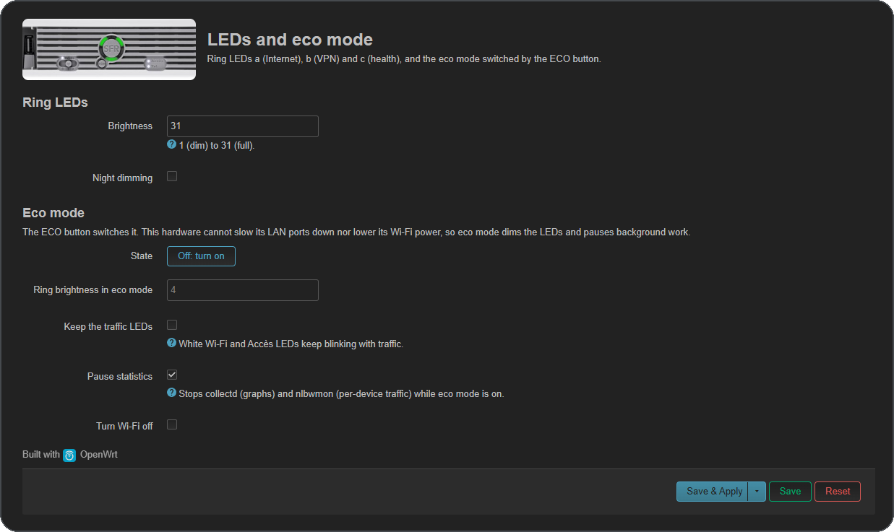

# LEDs and buttons

## LEDs (`/sys/class/leds`)
All 9 LEDs are driven by the SFR microcontroller (`nb6-hwmon`, PWM 0..31) through `pwm-leds`:

| sysfs name | Where | Used for |
|---|---|---|
| `red:service1` + `green:service1` | ring, top right | **Internet** LED |
| `red:service2` + `green:service2` | ring, bottom | **VPN** LED (tailnet / commercial) |
| `red:service3` + `green:service3` | ring, top left | **System** LED |
| `white:wan` | front | WAN traffic (netdev trigger on `extsw.2`) |
| `white:wlan` | front | Wi-Fi traffic (netdev trigger on `phy0-ap0`), blinks during WPS |
| `white:voip` | front | blinks 60 s when a new device gets a DHCP lease |

Orange = red 31 + green 10 (tune `color()` in `/usr/sbin/nb6-leds` if needed).

### `nb6-leds` daemon (`/etc/init.d/nb6-leds`)
| LED | Green | Orange | Red | Off |
|---|---|---|---|---|
| Internet | WAN link + ping 1.1.1.1 OK | WAN link, no internet | WAN cable unplugged | |
| VPN | tailnet up (handshake < 3 min); alternating with orange when both are up | commercial VPN up; blinking: connecting | | no tunnel up |
| System | OK | temperature > 70 °C or MemAvailable < 4 MB | blinking: dnsmasq/netifd dead or overlay full | |

Brightness and night mode: `/etc/config/nb6`, see [EXTRAS.md](EXTRAS.md#led-brightness-and-night-mode).

The daemon checks the states every 5 s (internet every 30 s, DHCP leases every 10 s); its 1 s loop only
handles blinking, and an LED is written only when its value changes.

## Buttons (`/etc/rc.button/*`)
| Button | Linux key / name | Action |
|---|---|---|
| SFR (top) | `BTN_0` | short press: tailnet tunnel `vpn` on / off; long press (≥ 3 s): commercial VPN `vpn_commercial` on / off; 3 red flashes on the VPN LED if that tunnel is not configured |
| ECO (top) | `BTN_1` | eco mode on / off (`nb6-eco`, see below) |
| Wi-Fi slide switch | `wlan` | ON position = radios on, OFF = radios off |
| Wi-Fi switch pushed further | `wps` | `hostapd_cli wps_pbc` on every AP, wlan LED blinks (500 ms) for 120 s |
| Reset (rear) | `reset` | OpenWrt default: < 5 s reboot, > 5 s factory reset |

## Sensors
`/sys/class/hwmon/hwmon*/` exposes `temperature` (m°C), `voltage` (mV), the same values under the
standard names `temp1_input` / `in0_input` (with `temp1_label` "board" and `in0_label` "12V"), `stats`
(boot/panic/oops counters), `release`, `leds_mode`, `watchdog`, `dmesg` (from the microcontroller).

## VPN
See [VPN.md](VPN.md): `nb6-vpn` sets up the tailnet and commercial tunnels used by the SFR button.

## Eco mode

The ECO button runs `nb6-eco toggle`. Settings in LuCI > Neufbox > LEDs and eco mode, or in `/etc/config/nb6`, section `eco`:

| Option | Default | Effect in eco mode |
|---|---|---|
| `led_brightness` | `4` | Internet, VPN and System LEDs dimmed to this value (1..31) |
| `traffic_leds` | `0` | `0`: white traffic LEDs (wan, wlan) off |
| `pause_stats` | `1` | `1`: statistics (collectd) and per-device traffic (nlbwmon) paused |
| `wifi_off` | `0` | `1`: Wi-Fi off too |

The state (`enabled`) survives a reboot (`/etc/init.d/nb6-eco` re-applies it). The original SFR firmware
also slowed the LAN ports down and lowered the Wi-Fi power; neither is possible here: the RTL8367R
driver only reads the port link, and b43 ignores transmit power changes.

## Hardware test results (2026-11-11)
- LED positions on the ring around the SFR button: Internet (service1) = top right, VPN (service2) = bottom,
  System (service3) = top left (SFR's documentation calls them a, b, c). Brightness 0..31; values above 31 switch the LED off.
- ECO: eco mode on and off (ring 31 → 4, traffic LEDs off, collectd and nlbwmon paused, then restored), 2026-11-13.
- SFR: short press tailnet off / on (VPN LED off, then orange blinking, then green); long press without a provider: 3 red flashes, 2026-11-13.
- Wi-Fi switch: off/on works.
- Sensors: temperature ~51 °C, voltage ~12.2 V, boot counter readable.
- I2C load: the SFR microcontroller refuses (NAKs) writes when LEDs change faster than ~2/s; traffic and WPS blinks are therefore 500 ms. The driver retries up to 5 times.
- **WPS: not working yet.** The press is detected, but hostapd in OpenWrt 25.12 exposes no `hostapd.<iface>` ubus object or `hostapd_cli` here, so `wps_start` cannot be called. In one test the access point dropped ~14 s after the WPS press and needed `wifi up`. To investigate.
